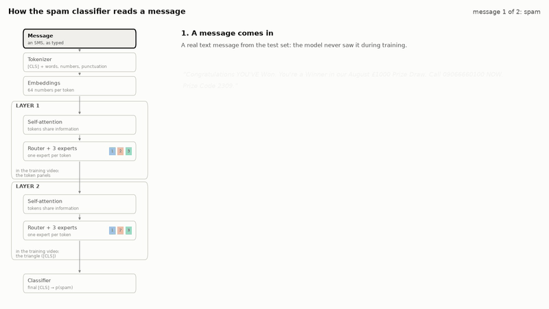
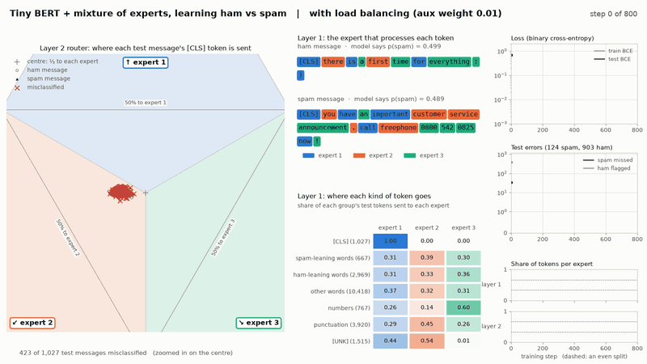
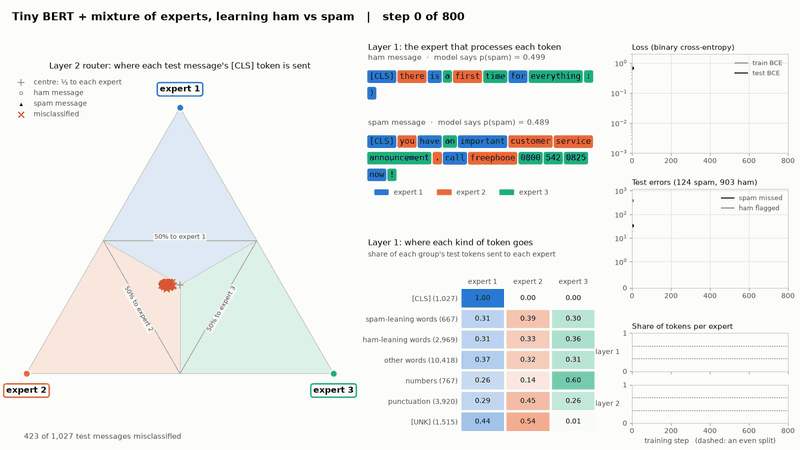
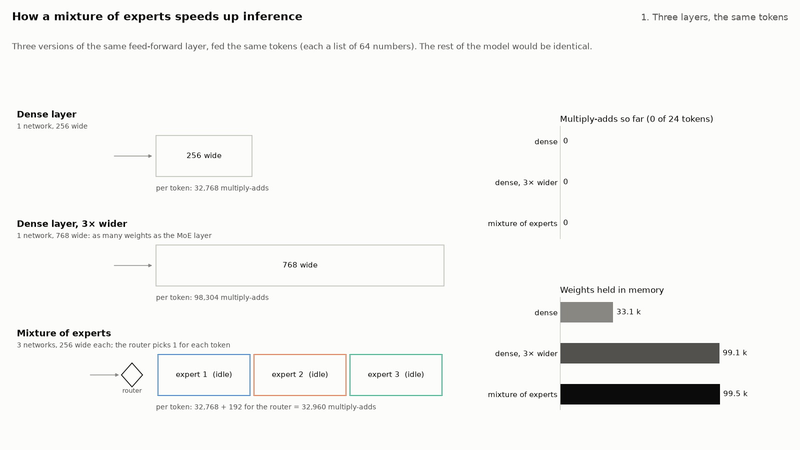
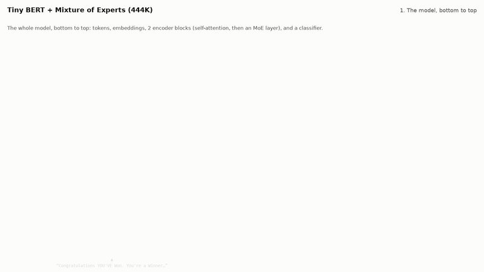
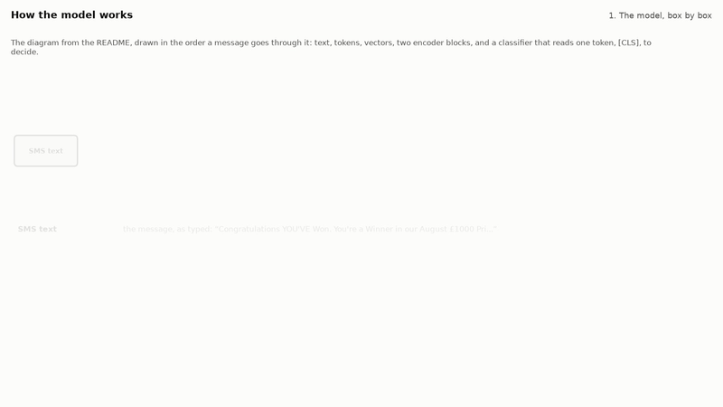
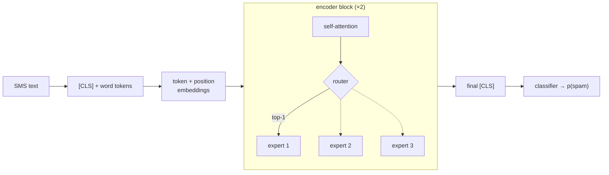

# Mixture of experts, learning ham vs spam

A small, readable project for learning how a mixture-of-experts (MoE) layer works
([Shazeer et al., 2017](https://arxiv.org/abs/1701.06538);
[Fedus et al., 2021](https://arxiv.org/abs/2101.03961)) by watching one learn.

A tiny BERT-style encoder ([Devlin et al., 2019](https://arxiv.org/abs/1810.04805)), built
from scratch in PyTorch, learns to tell spam text messages from normal ones ("ham") in the
[SMS Spam Collection](https://archive.ics.uci.edu/dataset/228/sms+spam+collection).
In a normal Transformer, every token goes through the same feed-forward network (FFN).
Here each FFN is split into **3 experts** with a small **router** in front: for every token,
the router picks one expert, and only that expert runs. The first video walks one message
through the trained model, so you can see where each layer sits. The second shows the router
learning where to send things, made the same way as the `ddpm-animation` training videos:
every frame runs the model on the same held-out messages, so two frames differ only because
the weights changed.

## Videos

### 1. How the model reads a message



[Full video (MP4)](media/architecture.mp4)

The trained model reads one spam and one ham message from the test set, one step at a time.
Everything shown is what the model actually computes: its tokens, its attention weights and
its router's choices. The **left** of each frame is a map of the model with the current step
lit up:

1. **Tokenizer:** the text becomes `[CLS]` + tokens; numbers become `[NUM]` or `[NUM5+]`.
2. **Embeddings:** each token becomes 64 numbers (8 shown).
3. **Layer 1, self-attention:** every token takes in information from the others. The bars
   show how much the `[CLS]` token takes from each one. In the spam message, the phone
   number gets 43% of it.
4. **Layer 1, router and experts:** each token flies to the one expert that processes it.
   These are the choices the training video's **token panels** show. In the spam message,
   "won", "winner", "prize" and the phone number all go to expert 1.
5. **Layer 2, self-attention** again, with its own weights.
6. **Layer 2, router and experts.** The `[CLS]` token's choice here is the point the
   training video's **triangle** plots for this message, shown as a small triangle on the
   right. The spam's `[CLS]` goes to expert 1 (the router gives it 0.38, and 0.34 to expert
   2), as does the `[CLS]` of 63 of the 124 test spam messages. The ham's goes to expert 2
   (0.46), as it does for all 903 test ham messages.
7. **Classifier:** only the final `[CLS]` is read, to give p(spam).

Run `moe-spam architecture-video` after training to make it again. It picks the examples
from the test set by itself: messages the model gets right, with no unknown words and at
most 24 tokens (so they fit on screen), whose layer-2 `[CLS]` goes where most of their class
goes, preferring ones with little punctuation.

### 2. Training, with load balancing



[Full video (MP4)](media/training_moe.mp4)

Step 0 is the untrained model; then one frame every 5 training steps. The title says whether
the run uses the load-balancing loss: this one does, with weight 0.01 (the default). Each frame
shows:

- **Left: where each message goes in layer 2.** One point per test message (1,027 of them;
  hollow circles are ham, filled triangles spam, red crosses the ones the model gets wrong).
  The position is the layer-2 router's probabilities for that message's `[CLS]` token: the
  closer to an expert's corner, the more of it goes to that expert; the `+` is a three-way
  tie. The tinted regions show which expert actually runs (the router's top choice), and the
  thin lines mark where one expert gets half. `[CLS]` is the token the classifier reads, so
  this is the one routing decision per message that feeds the prediction. The view is zoomed
  in on the centre (the same zoom for the whole video), because the router never gets very
  sure (see [Things worth noticing](#things-worth-noticing)).
- **Middle top: tokens of two test messages**, each boxed in the color of the expert that
  processed it in layer 1, with the model's spam probability for the whole message.
- **Middle bottom: where each kind of token goes in layer 1.** Each row is a group of test
  tokens; the cells are the share that each expert gets. Spam-leaning words are words (used
  at least 5 times) that appear in spam at least 80% of the time in the *training* messages,
  ham-leaning ones at most 2% of the time.
- **Top right: the loss**, on as many training messages as test messages, measured the same
  way for both (the averaged weights, no dropout), so the gap between them is overfitting.
- **Middle right: test mistakes**, as counts: spam that got through, and ham flagged as spam.
- **Bottom right: each expert's share of all tokens**, per layer. The dashed lines are where
  the borders would sit if the experts got a third each.

### 3. The same training without load balancing



[Full video (MP4)](media/training_moe_noaux.mp4)

The same model, data and seed, with the load-balancing loss switched off (`--aux-weight 0`);
the title of every frame says so. The router becomes far more sure of itself, and layer 2 piles most tokens onto one expert
(bottom right).

### 4. How a mixture of experts speeds up inference



[Full video (MP4)](media/inference.mp4)

Three versions of one feed-forward layer read the same tokens of a test message:

- **a dense layer** (one network, 256 wide);
- **a dense layer 3× wider** (768), which holds as many weights as the MoE layer;
- **the MoE layer**, where the trained model's layer-1 router sends each token to one of 3
  experts, so the other two sit idle.

The counters add up the work: 32,768 multiply-adds per token for the dense layer, 98,304 for
the wide one, and 32,960 for the MoE layer (one expert plus a 192-weight router). The MoE
layer does a third of the wide layer's work while holding the same weights: **MoE saves
compute, not memory.**

The last three scenes measure what that is worth in time, on this computer (Apple M4 Max, CPU),
by `moe-spam inference-video`. These are the numbers in the video; they vary between runs, most
at this project's tiny size.

**4. Many tokens at once (throughput):** one layer, batches of 8,192 tokens, time per 1,000
tokens. This is how a server busy with many messages runs.

| Layer size | Dense | Dense, same weights as MoE | MoE (top-1) |
| --- | --- | --- | --- |
| This project's (64 → 256, 3 experts) | 0.21 ms | 0.39 ms | 0.74 ms |
| Large (1,024 → 4,096, 8 experts) | 7.20 ms | 62.46 ms | 11.36 ms |

**5. One message at a time (latency):** one layer, one 24-token message (batch of 1), the way
a spam filter is called. Median of 300 runs.

| Layer size | Dense | Dense, same weights as MoE | MoE (top-1) |
| --- | --- | --- | --- |
| This project's (64 → 256, 3 experts) | 21 µs | 109 µs | 1,228 µs |
| Large (1,024 → 4,096, 8 experts) | 1,308 µs | 4,670 µs | 12,347 µs |

**6. The whole trained classifier:** the dense model (one 256-wide network per layer) against
the MoE model (3 experts per layer), end to end, with attention, embeddings and the classifier
included.

| Model | One message | All 1,027 test messages at once, per 1,000 |
| --- | --- | --- |
| Dense model | 1.44 ms | 84.1 ms |
| MoE model | 2.95 ms | 94.4 ms |

What they show:

- **With many tokens at once and large experts, the saving becomes speed.** The MoE layer
  runs 5.5× faster than a dense layer with the same weights (5.5–6.0× over five runs; 8× would
  be perfect), and about 1.5× slower than a single expert, because routing and gathering the
  tokens cost something.
- **One message at a time, MoE is slower, even with large experts** (2.5–2.6× slower than the
  dense layer with the same weights). A message's tokens spread over almost every expert:
  this one uses all 3 in layer 1, and 24 tokens spread over 8 experts reach 7.7 of them on
  average. So almost every expert's weights must be read anyway, which is what dominates time
  for small batches, and each expert adds its own overhead. MoE's speed-up needs big batches.
- **At this project's tiny size, routing overhead wins everywhere.** The MoE layer was slower
  than the wide dense layer with many tokens (1.1× to 3.6× over seven runs) and much slower for
  one message (11× and 26× in two runs; microsecond timings are noisy).
- **The whole MoE classifier is slower than the dense one:** 2.1× for one message, 1.1× for
  the whole test set. It does the dense model's work per token plus routing, so at this size
  it can only lose. Accuracy is the same (see the results below).
- **Part of the overhead is this project's simple MoE layer**, written to be read: a Python
  loop over the experts, and the load-balancing loss computed even at inference. Production
  MoE code runs all experts in one grouped operation and skips the training-only parts.

### 5. The model as an architecture diagram



[Full video (MP4)](media/model_diagram.mp4)

The whole model drawn the way large language models are usually drawn (in the style of
Sebastian Raschka's LLM architecture diagrams, such as DeepSeek V3's), and animated with the
trained model's own numbers (`moe-spam model-diagram-video`):

1. **The model, bottom to top:** tokenized text, token + position embeddings, the encoder
   block repeated 2×, the final LayerNorm and the output layer, annotated with the real
   sizes: a vocabulary of 3,241 tokens, a context of 64 tokens, an embedding dimension of 64.
2. **One message through it:** a test spam's `[CLS]` token goes box to box up through
   block 1, back down, up through block 2, and comes out as p(spam) = 0.998. Beside it, a log
   fills in as the token reaches each step: its 24 tokens, its 64 embedding numbers, the
   tokens its attention takes most from in each layer (43% from the phone number in layer 1),
   each router's 3 probabilities and choice, and the p(spam) gauge.
3. **Inside the MoE layer:** the router and its 3 feed-forward experts. Each of the
   message's 24 tokens goes through the trained router in turn: its 3 probabilities, the
   expert it is sent to, and a running count per expert (4, 8 and 12 tokens in the end).
4. **Inside one expert:** Linear 64 → 256, GELU, Linear 256 → 64: 33,088 parameters.
5. **What MoE saves:** the model has 444,417 parameters, but a token goes through only
   312,065 of them (70%), because 2 of the 3 experts in each layer do nothing for it.

Every number is read from the trained checkpoint: the parameter counts are counted on the
model itself, and the routing and p(spam) come from running it on the message.

## Results after 800 steps (default settings)

On the 1,027 test messages (124 spam, 903 ham):

| Run | Errors | Spam missed | Ham flagged | Spam F1 |
| --- | --- | --- | --- | --- |
| Bag-of-words logistic regression (`moe-spam baselines`) | 16 | 15 | 1 | 0.932 |
| Dense tiny BERT, 1 expert (`--experts 1`) | 15 | 14 | 1 | 0.936 |
| MoE, 3 experts, seed 0 (video 2) | 17 | 12 | 5 | 0.929 |
| MoE, seeds 0–4 | 13–20 | 10–12 | 3–9 | 0.919–0.946 |
| MoE without load balancing, seed 0 (video 3) | 18 | 13 | 5 | 0.925 |
| MoE without load balancing, seeds 0–4 | 12–22 | 9–15 | 2–8 | 0.909–0.950 |

Every model gets 98–99% right. The task is easy enough that a linear model on word
counts does as well, so these numbers say nothing for or against MoE (see below).
What does differ is the routing, over the same five seeds:

| | With load balancing | Without |
| --- | --- | --- |
| Layer 2 sends spam's `[CLS]` to an expert that ham's does not use | 4 of 5 seeds, for 51–85% of spam | 5 of 5 seeds, for 85–91% of spam |
| Router's top probability for `[CLS]`, median (seed 0) | ham 0.46, spam 0.38 | ham 0.78, spam 0.67 |
| Busiest expert's share of layer-2 tokens | 36–39% | 74–83% |
| Busiest expert's share of layer-1 tokens | 35–40% | 36–62% |

## How it works



[Full video (MP4)](media/how_it_works.mp4)

The diagram and the equations below, animated with the trained model's own numbers
(`moe-spam how-it-works-video`):

1. **The model, box by box:** the diagram is built in the order a message goes through it,
   with one line on what each box does.
2. **One message through it:** the `[CLS]` token of a test spam travels through both layers;
   the router of each sends it to one expert, and the classifier reads it at the end.
3. **The router's softmax**, $`p = \mathrm{softmax}(W_{\text{router}}\,x)`$: for one word of
   that message in layer 1, each row of the router's weights scores one expert, and softmax
   turns the scores into probabilities.
4. **The argmax**, $`i = \arg\max_j p_j`$: only the most likely expert runs; the other two do
   no work for it.
5. **The scaled output**, $`y = p_i \cdot \mathrm{FFN}_i(x)`$: the token goes through that
   expert (64 → 256 → 64), and the output is scaled by $`p_i`$.
6. **Why multiply by $`p_i`$?** As expert $`i`$'s score changes, the argmax only jumps, while
   $`p_i`$ changes smoothly. That slope is what lets the classification loss train the router;
   the video shows the real $`\partial L / \partial p_i`$ for this message.
7. **Load balancing:** $`f_i`$ and $`P_i`$ of each expert over the test set, in both layers,
   and the $`\mathrm{aux}`$ loss they add up to.

The equations in the video are typeset in matplotlib's LaTeX-style mathtext, so no LaTeX
installation is needed.



For each token $`x`$ (after self-attention), the MoE layer does
([Switch Transformer](https://arxiv.org/abs/2101.03961) routing):

```math
\begin{aligned}
p &= \mathrm{softmax}(W_{\text{router}}\, x) && \text{the router's probabilities over the 3 experts} \\
i &= \arg\max_{j}\; p_j && \text{the one expert that runs on this token (top-1)} \\
y &= p_i \cdot \mathrm{FFN}_i(x) && \text{its output, scaled by its probability}
\end{aligned}
```

The argmax has no gradient, so multiplying by $`p_i`$ is what lets the classification loss
teach the router: if expert $`i`$'s output helped, $`p_i`$ goes up.

Left alone, a router tends to send more and more to whichever expert is ahead, so training
adds the Switch **load-balancing loss**:

```math
\mathrm{aux} = 3 \sum_{i=1}^{3} f_i \, P_i, \qquad
\mathcal{L} = \mathrm{BCE} + 0.01 \cdot \mathrm{aux}
```

where $`f_i`$ is the share of tokens sent to expert $`i`$ (no gradient flows through it),
$`P_i`$ is the router's mean probability for expert $`i`$, and BCE is the binary
cross-entropy. $`\mathrm{aux}`$ is 1 when tokens and probability are spread evenly and 3 when
everything goes to one expert. Pads are left out of both.

**Why bother with experts at all?** The MoE model has three times the FFN weights of the
dense one (444,417 parameters against 311,809 in all), but each token still runs through one
expert's 33,088 FFN weights plus a 192-weight router. More parameters for about the same
compute per token is what MoE buys in large models; on a task this small it cannot show.
Video 4 counts that saving and measures when it turns into speed.

**Why two layers, for such a small task?** Not for accuracy: the bag-of-words model has no
layers at all and does as well (98.4%). Two is the smallest stack in which both kinds of
routing in the videos matter:

- The classifier reads only the final `[CLS]`. In the last layer, the expert output of every
  other token feeds nothing, so where those tokens go cannot change the prediction.
- With **one layer**, that last layer would be the only one. The token panels and the flying
  tokens would show routing that cannot affect the answer; only `[CLS]`'s choice would count.
- With **two layers**, layer 1's routing of every token matters, because its output feeds
  layer 2's attention: that is what the token panels show. Layer 2's routing of `[CLS]` is
  the one per-message decision: that is the triangle.
- Two layers also show that each layer has its own router. The same tokens go to different
  experts in layer 1 and layer 2 (video 1), and without load balancing layer 2 collapses
  while layer 1 mostly does not (video 3).

Each layer adds about 116,000 parameters to the 444,417 of the whole model.

**The model:**

- **Tokens:** lowercase words, digit runs and punctuation marks. Numbers become `[NUM]` (up
  to 4 digits) or `[NUM5+]` (phone numbers, short codes). The vocabulary holds `[PAD]`,
  `[UNK]`, `[CLS]` and the 3,238 tokens seen at least twice in the training messages; the
  rest become `[UNK]`. Each message starts with `[CLS]` and is cut at 64 tokens (98.8% of
  messages fit whole).
- **Encoder:** 2 blocks, width 64, 4 attention heads, LayerNorm before each sublayer, dropout
  0.1. Each expert is `Linear(64, 256) → GELU → Linear(256, 64)`. The router is
  `Linear(64, 3)`, initialised with small random weights: zero weights would tie every
  expert, and the argmax would break that tie the same way for every token.
- **Classifier:** a LayerNorm and `Linear(64, 1)` on the final `[CLS]` token.
- **Training:** AdamW (learning rate 1e-3, weight decay 0.01), 100 warmup steps then a linear
  decay to 0, batches of 64 messages, 800 steps. The frames, the checkpoint and every number
  reported come from a moving average of the weights (decay 0.99), which changes more smoothly
  from frame to frame than the raw weights.
- **Data:** 5,574 messages. Many spams are one template sent with different numbers, so
  messages that match after lowercasing and replacing every number with `0` count as one,
  which leaves 5,137 (4,517 ham, 620 spam). A stratified 80/20 split gives 4,110 training and
  1,027 test messages.

**Not quite BERT, on purpose:** whole words instead of word pieces, no sentence-pair segment
embeddings, no pooler, LayerNorm before each sublayer rather than after (it trains more
reliably from scratch on little data), and no masked-language-model pre-training: the model
learns from the ham/spam labels alone.

## Running a training

### 1. Install

```bash
python -m venv .venv
# Windows: .venv\Scripts\activate    macOS/Linux: source .venv/bin/activate
pip install -e ".[dev]"
```

This installs the `moe_spam` package (editable, from `src/`), the `moe-spam` command and the
test tools. Needs Python 3.10 or newer; everything runs on the CPU. `imageio-ffmpeg` brings
its own ffmpeg.

To get the exact library versions the videos were made with (font rendering and timings can
differ slightly between versions), install those first:

```bash
pip install -r requirements-lock.txt
pip install -e . --no-deps
```

### 2. Get the data

Download the [SMS Spam Collection](https://archive.ics.uci.edu/dataset/228/sms+spam+collection)
(about 200 KB) and unzip it into `data/raw/sms/`:

```bash
mkdir -p data/raw
curl -L -o data/raw/sms_spam_collection.zip "https://archive.ics.uci.edu/static/public/228/sms+spam+collection.zip"
unzip data/raw/sms_spam_collection.zip -d data/raw/sms
```

The commands check the file's SHA-256
(`7d039a24a6083ed9ef0f806ebad56bbb976e3aeb8de05669173bfdc4996c239d`) and refuse anything else.

### 3. Train

Run every command from the repository root (the data, results and videos are found by
paths relative to it). `moe-spam --help` lists the commands, `moe-spam <command> --help` their
options, and `python -m moe_spam` works the same as `moe-spam`.

```bash
moe-spam train                          # video 2
moe-spam train --aux-weight 0           # video 3
moe-spam train --experts 1 --no-video   # the dense model, for comparison
moe-spam baselines                      # the bag-of-words model and the results table
moe-spam architecture-video             # video 1, from the trained model in checkpoints/
moe-spam inference-video                # video 4: measures layers and both models, then draws
moe-spam inference-video --reuse        # video 4 again, with the timings already saved
moe-spam how-it-works-video             # the diagram and routing equations, animated
moe-spam model-diagram-video            # video 5: the architecture diagram, animated
moe-spam benchmark                      # only the layer timings, into results/
```

A run with a video takes about 100 seconds on an Apple M4 Max: about 60 s training and
evaluating, 30 s drawing 161 frames, 5 s encoding. It prints progress, saves the model to
`checkpoints/<run>.pt`, the history and final numbers to `results/training_<run>.{csv,json}`,
the frames to `frames/training_<run>/` and the video to `media/training_<run>.{mp4,gif}`.
The run name is `moe`, `moe_noaux` or `dense`, followed by every setting that differs from
its default (`moe_seed2`, `moe_steps400`), so runs never overwrite each other.

### 4. Training options

| Option | Default | Meaning |
| --- | --- | --- |
| `--steps` | 800 | Training steps (one batch each) |
| `--batch-size` | 64 | Messages per step |
| `--lr` | 1e-3 | Peak AdamW learning rate |
| `--experts` | 3 | Experts per MoE layer; 1 is a plain dense BERT. The video needs 3 |
| `--aux-weight` | 0.01 | Weight of the load-balancing loss; 0 switches it off |
| `--frame-every` | 5 | Evaluate (and draw a frame) every N steps; it does not change training |
| `--seed` | 0 | Seed for the weights and the batches (the split is always the same) |
| `--no-video` | off | Only train and write the run record |

To rebuild a video from saved frames:

```bash
moe-spam encode-video frames/training_moe media/training_moe
```

The video commands take the checkpoint to draw (by default `checkpoints/moe.pt`), `--fps`
and `--no-video` (only draw the frames).

### 5. Tests

```bash
python -m pytest --cov     # tests and coverage
ruff check .               # style, imports and Google-style docstrings
```

About 190 tests, in about 40 seconds. Among other things they check that:

- An MoE layer with one expert is exactly the dense FFN.
- The sparse dispatch matches a dense "sum over all experts" reference.
- The load-balancing loss is exactly 1 for even routing and 3 for total collapse.
- Padding and batch-mates never change a message's score.
- The router learns from the classification loss alone.
- A seeded run reproduces exactly.

Coverage is about 99%.

## Things worth noticing

- **Spam can get an expert of its own, in layer 2.** In video 2, all ham `[CLS]` tokens go to
  expert 2. Between steps 150 and 250 the spam moves out along a line, and most of it crosses
  into expert 1's territory. Over the rest of training some of it drifts back, leaving about
  half (51%) with expert 1 at the end. Over five seeds this happens in four, with 51–85% of
  spam crossing. In the fifth, ham and spam share one expert to the end. Nothing in the loss
  asks for this split. The router finds it because ham and spam `[CLS]` vectors end up far
  apart. The points line up because the router's view of `[CLS]` is dominated by one
  direction: how spammy the message looks.
- **The router never gets very sure.** With load balancing, the median top probability for
  `[CLS]` is 0.46 for ham and 0.38 for spam, not far above a three-way tie (0.33); for all
  tokens it is 0.38–0.39. In top-1 routing a token's output is $`p_i \cdot \mathrm{FFN}_i(x)`$,
  and the expert can make its output larger to make up for a small $`p_i`$, so nothing pushes
  $`p_i`$ towards 1. The load-balancing loss also rewards spreading probability. Without that loss,
  `[CLS]` routing reaches 0.67–0.78, which is why video 3 needs a much wider view.
- **Without load balancing, layer 2 collapses but layer 1 mostly does not.** In layer 2, the
  busiest expert gets 74–83% of the tokens in all five seeds. In layer 1 it gets 36–62%, and
  more than 45% in only two seeds. A likely reason:
  - The classifier reads only `[CLS]`, so in the last layer the MoE output of every other
    token is never used, and their routing gets no gradient from the task.
  - The router's weights are still pushed around by `[CLS]` (88% of which is ham, heading
    for one expert), and the other tokens are dragged along. Only the load-balancing loss
    holds them back.
  - In layer 1, every token's output feeds the next layer's attention, so every routing
    choice matters to the task.
- **Experts specialise by kind of token, not by spam or ham words.** At the end of video 2,
  layer 1 sends:
  - 59% of numbers to expert 3,
  - 79% of `[UNK]` tokens and 53% of punctuation to expert 2,
  - 90% of `[CLS]` tokens to expert 1.

  Spam-leaning words split evenly between experts 2 and 3. Part of this is there before
  any training: at step 0, numbers already go 60% to expert 3. A router that reads token
  embeddings sends every copy of the same token the same way, and every number is one of
  two tokens. Training sharpens `[UNK]` (54% → 79%) and loosens `[CLS]` (100% → 90%): it
  starts the same in every message, so only what attention adds can tell its copies apart. This is also what
  larger MoE models show: experts tend to specialise by token type and syntax more than by
  topic ([Jiang et al., 2024](https://arxiv.org/abs/2401.04088), section 5).
- **Accuracy is the same with or without experts.** MoE, dense and bag-of-words all make
  12–22 mistakes out of 1,027. Spam on this dataset is mostly recognisable from a few words
  and numbers, which a linear model already catches. MoE pays off when a model needs more
  capacity than its compute budget allows, which a 5,000-message dataset never asks for.
- **It overfits after about step 350.** The test loss is lowest at step 365 (0.065) and then
  creeps up to 0.077, while the training loss keeps falling to 0.015 (top right). Spam
  missed settles at 12–13 from step 400, but ham flagged rises from 2 to 5. There is no
  separate validation split, and the 800 steps were chosen by watching the test loss, so the
  test numbers are slightly optimistic.

## Ideas for further experiments

- **Top-2 routing:** send each token to its two best experts and mix them, as
  [Mixtral](https://arxiv.org/abs/2401.04088) does. The routing becomes smoother, and the
  load harder to define.
- **Expert capacity:** cap the tokens each expert may take per batch and drop the overflow,
  as the Switch Transformer does. Then watch how many tokens get dropped without load
  balancing.
- **Router z-loss** ([Zoph et al., 2022](https://arxiv.org/abs/2202.08906)) or noisy gating
  ([Shazeer et al., 2017](https://arxiv.org/abs/1701.06538)), and their effect on how sure
  the router gets.
- **Mean pooling instead of `[CLS]`**, so every token's last-layer output reaches the
  classifier. Does the layer-2 collapse without load balancing go away?
- **Masked-language-model pre-training first**, as BERT does, then fine-tuning on the labels.
  Do the experts specialise differently when every token has a prediction to make?
- **More experts** (the triangle only fits 3; the token panels and load strips work for any
  number).

## Project layout

The code is one package, `moe_spam`, in `src/`. Its sub-packages depend on each other in one
direction only: `data` → `model` → `analysis` → `training` → `viz` → `cli`.

```
pyproject.toml            package metadata, dependencies, the moe-spam command, pytest and ruff
src/moe_spam/
  paths.py                where the data, results, checkpoints, frames and videos go
  errors.py               MoeSpamError: problems the user can fix, reported without a traceback
  records.py              run records: CSV/JSON output, environment, file hashes
  data/
    sms.py                the SMS Spam Collection: reading, checksum, deduplication, split
    tokenizer.py          words, numbers ([NUM], [NUM5+]) and punctuation
    vocab.py              vocabulary, encoding, token groups for the heatmap
    dataset.py            SpamData: the split, vocabulary and encoded messages, in one object
  model/
    moe.py                the MoE layer: router, top-1 dispatch, load-balancing loss
    bert.py               the tiny BERT: embeddings, encoder blocks, [CLS] classifier
    checkpoint.py         save and load a trained model with its settings and vocabulary
    modes.py              run a model in eval mode and give its mode back
  analysis/
    trace.py              follow one message through a trained model
    examples.py           pick the example messages the videos show
    routing.py            the router's arithmetic for one token, and each layer's balance
    model_facts.py        the model's sizes and parameter counts (total and per token)
    benchmark.py          count the work and weights of dense vs MoE layers, and time them
  training/
    config.py             TrainingConfig: every setting, its default and the run name
    trainer.py            the training loop, EMA weights, checkpoint and run record
    evaluator.py          test-set metrics and the routing state each frame shows
    history.py            what is logged at each evaluation
    scores.py             errors, accuracy and spam F1
    baselines.py          bag-of-words logistic regression and the results table
  viz/
    style.py, canvas.py   colors, fonts and the 1600x900 figure every frame is drawn on
    video.py              Video: the base class that times, draws and encodes a scripted video
    encoder.py            frames -> MP4 + GIF
    ternary.py            the routing triangle
    panels.py             token rows, heatmap, load strips, curves
    training/frames.py    the training video's frames
    architecture/         the "how the model reads a message" video: layout, model map,
                          one drawing per step, script (beats and captions), video
    inference/            the "how MoE speeds up inference" video: lanes and bar charts,
                          script, video
    how_it_works/         the "how it works" video: the diagram, the routing equations'
                          drawings, script, video
    model_diagram/        the architecture-diagram video: shapes, the stack, the zoomed-in
                          MoE layer and expert, script, video
    motion.py             movement shared by the videos: a travelling token, a token stream
  cli/                    the moe-spam command: one Command class per subcommand
tests/                    pytest suite
results/                  run records written by the commands
media/                    the videos and GIFs
frames/                   per-frame images (generated)
checkpoints/              trained models (generated)
data/raw/                 the downloaded dataset (not included)
```

## Data and credits

The SMS Spam Collection is by Tiago A. Almeida, José María Gómez Hidalgo and Akebo
Yamakami: *Contributions to the Study of SMS Spam Filtering: New Collection and Results*,
ACM DocEng 2011, distributed by the UCI Machine Learning Repository. The authors ask that
work using it cite that paper and the collection's web page; their full terms are in the
`readme` inside the download. The video layout and the "same inputs every frame" approach come from the
sibling `ddpm-animation` project. The architecture-diagram video follows the layout of
Sebastian Raschka's LLM architecture diagrams. Chart colors follow a colorblind-checked
palette.
